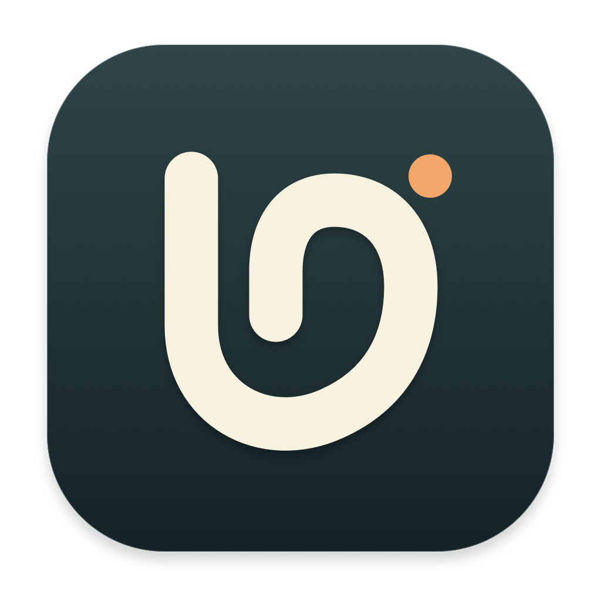

# LocalDictation · 本地口述



在 Mac 上按快捷键说话，结束后把整理好的文字填入当前输入框。音频识别与默认文字整理都在本机运行。

Mac 源码版本：**0.5.21 测试版**；当前 Mac 公开下载为 **0.5.8**。首发支持 **Apple Silicon Mac / macOS 14 或更新版本**。Windows x64 首个预览版使用 WPF、CPU Whisper 和 Qwen；[Windows 下载](https://github.com/WillfordZhan/LocalDictation/releases/tag/v0.6.0-windows-preview.1)与[安装说明](windows/README.md)独立提供。Windows 自动纠错学习、热力图和 GPU 加速尚未移植。

## 使用

1. 从[Mac 下载页](https://github.com/WillfordZhan/LocalDictation/releases/tag/v0.5.8)下载 `LocalDictation-0.5.8-AppleSilicon.zip`，解压后将应用放入 Applications。
2. 打开应用，使用内置配置检查与模型下载。发行包包含 Python 运行环境，模型在首次使用时下载到应用外。
3. 允许麦克风和辅助功能；使用单独 Fn 时还需输入监控。也可以在设置中改为组合快捷键。
4. 点击目标输入框，按一下快捷键开始，再按一下结束。整理期间可以继续说下一段。

这个测试包使用本地开发签名，尚未经过 Apple Developer ID 公证。首次打开若被 macOS 拦截，请在系统设置的“隐私与安全性”中核对来源后选择“仍要打开”。正式公证与跨设备安装验证仍在后续工作中。

## Mac 能力

- **边说边识别**：Qwen3-ASR 中文识别，停录后使用全文进行一次整理，保留跨段改口上下文。
- **后台口述**：关闭主窗口后仍可通过快捷键录音；多段分别显示状态并依次填入。
- **应用外观**：设置中选择“跟随系统 / 浅色 / 深色”，无需重开窗口；图标默认随应用外观使用柔雾显影或暗色辉光，也可关闭跟随并手动选点阵成型、柔雾显影或暗色辉光。选择保存在应用外，重启和升级后恢复。详见[图标行为与验证](docs/app-icons.md)。
- **波形选择**：设置中可切换“灵动 / 柔和”，保持声音起落的及时响应；录音与整理浮窗使用统一的紧凑宽度。
- **本地模型切换**：首页可直接选择 Qwen3 ASR / Whisper，以及 Qwen3.5 4B（默认）/ 9B；切换时显示加载动画，模型实际加载完成后显示“已就绪”。首次只下载所选模型，已有文件直接复用。切换须等待口述与整理完成，选择在重启后保留。“模型与配置”仍可检查完整运行环境和权限。
- **更快整理**：复用固定规则与示例的计算结果；首次请求仍需建立缓存，长段仍需逐字生成。
- **自然表达**：Prompt 版本可以查看、编辑、试用和切换，历史记录保留当次模型与规则信息。
- **历史润色测试**：选取一条 ASR 原文，组合不同 Prompt 与已安装的本地 4B / 9B 模型，另存测试结果；可对比原文、原输出和各次测试，并查看模型、规则、耗时与处理状态。测试不会改变日常模型或生效规则，也不会自动粘贴。测试其他模型时会额外占用内存并产生加载等待，完成后释放临时模型。
- **个人词典**：按“全部 / 自动添加 / 手动添加”查看词条；同一段中的高置信度术语纠正可连续学习，小写英文短词组纠正先询问是否记住。支持撤销，手动保留的词不会随纠错规则一起删除。已确认的易错拼写可供整理模型结合上下文参考。自动学习需要目标应用提供可读的辅助功能文本，目前仅跟踪本次自动填入的文字。
- **每日记录**：本机统计口述次数、字数和时长，热力图可悬停查看。
- **可恢复交付**：不能自动填入时保留剪贴板和历史，提示按 Command-V 粘贴；成功派发粘贴后不反复弹复制提醒。

文字整理属于模型生成，不能保证每次都准确。保留 ASR 原文和原输出是为了方便对照。0.5.4 专门修复了低信号片段复述整份词典的问题，但它不是所有噪声或识别幻觉的通用过滤器。

## 数据

历史、词典、Prompt 和统计位于 `~/Library/Application Support/LocalDictation/`，更新应用包不会清空。历史主文件与镜像独立于应用保存。自动学习只保留确认的术语纠错，不上传输入框正文。

详见 [隐私说明](PRIVACY.md)、[版本记录](CHANGELOG.md) 与 [第三方声明](THIRD_PARTY_NOTICES.md)。

## 开发

项目包含原生 AppKit 界面与本机 Python 服务。当前开发环境为 Apple Silicon Mac、Xcode Command Line Tools 和 Python 3.11。

```sh
# 后端协议测试：不下载模型、不访问麦克风
python3 -m pip install 'numpy>=1.26,<3'
(cd backend && python3 -m unittest discover -p 'test_*.py' -q)

# 原生布局、存储、快捷键和传输测试
bash macos/test.sh
```

`backend/model-manifest.json` 固定可下载模型的仓库和版本，`backend/requirements.txt` 列出推理环境依赖。模型权重不放入 Git 仓库，也不捆绑进应用安装包。

构建原生应用：

```sh
python3 macos/signing/local_signing.py initialize
bash macos/build.sh "$PWD/build/LocalDictation.app"
```

这个命令可用于已有本地 Runtime 的开发环境。完整可分发包还需准备便携 Python，清理本机构建元数据、保留依赖许可证并验证重定位，然后使用：

```sh
LOCAL_DICTATION_PYTHON_BUNDLE=/absolute/path/to/validated-python \
  bash macos/build.sh "$PWD/build/LocalDictation.app"
bash packaging/package.sh "$PWD/build/LocalDictation.app" "$PWD/releases/0.5.4"
```

详见 [打包说明](packaging/README.md)。构建脚本为当前开发者创建并复用本地签名身份；私钥存放在应用外，不能提交或共享。首次下载的公开应用和自行构建的应用签名不同，macOS 可能需要重新授权。

## 路线

继续完善 Mac 的真实输入框兼容性、低信号识别、术语纠正和安装体验。Windows 已提供独立预览实现，下一步验证真实麦克风和日常编辑器，并优化 CPU 首次整理速度；分别标明已实现能力与尚未验证的兼容性。

## 许可

项目原创代码使用 [MIT](LICENSE)。Python、MLX、模型及其他依赖保留各自许可；本项目不包含 Typeless 的提取源码或品牌素材，也不隶属于 Typeless。
